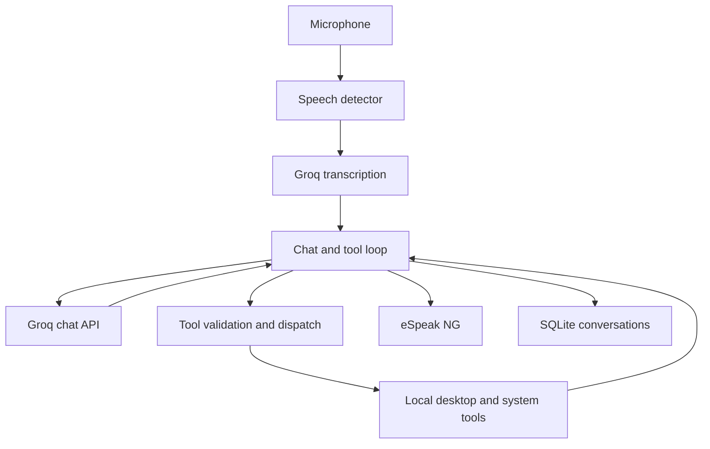

# Linux Voice Agent

A Python voice assistant that turns spoken requests into Linux desktop actions using Groq and validated local tools.

Speak a request such as “Create a folder in Downloads named voice demo and initialize Git inside it.” The assistant transcribes the audio, selects tools, executes the steps locally, and speaks a response.

Built as a practical project for learning AI agents, backend architecture, Linux integration, and interview concepts through implementation.

## Features

- Automatic microphone listening with session-level noise calibration and silence-based recording boundaries.
- Speech recognition through Groq Whisper with configurable language and vocabulary hints.
- Groq chat completions with a bounded local tool-calling loop.
- Local spoken replies through eSpeak NG.
- CPU and RAM measurements using psutil.
- Resolve Desktop and Downloads through Linux XDG settings.
- Open folders in the desktop file manager.
- Create directories and initialize Git repositories.
- Create UTF-8 files without overwriting existing files.
- List directory entries and maintain a logical task directory for “here.”
- Save sessions and completed conversation exchanges in SQLite.

## Example requests

- “Check my current CPU and memory usage.”
- “Open my Downloads folder.”
- “Create a folder in Downloads named voice demo and initialize Git inside it.”
- “Open voice demo in Downloads.”
- “Create index.html here and list the files here.”
- “Explain dependency injection.”
- “Ask me one interview question about Node.js.”

These are example requests, not hardcoded sentence handlers. The model selects from registered tools and supplies arguments. Recognition and tool selection can vary; inspect the recognized text and actual results.

## Architecture



The model requests operations; Python executes them. The registry validates tool arguments, and filesystem tools validate permitted paths. The current GroqChatClient combines provider communication and tool orchestration.

## Project structure

```text
src/voice_agent/
├── config.py
├── main.py
├── voice_main.py
├── agent/
│   ├── client.py
│   ├── prompts.py
│   └── loop.py
├── audio/
│   ├── recorder.py
│   ├── speech_detector.py
│   ├── transcriber.py
│   └── speaker.py
├── tools/
│   ├── registry.py
│   ├── system_info.py
│   ├── files.py
│   ├── desktop.py
│   └── file_operations.py
├── security/
│   └── policy.py
└── storage/
    └── database.py
scripts/
docs/
tests/
deploy/
data/                    # Local runtime data; excluded from Git
```

Some scaffold files may remain placeholders. The supported startup command is voice_main; a test or deployment directory does not imply a completed test suite or service configuration.

## Requirements

- Ubuntu/Debian Linux desktop with a microphone and speakers or headphones.
- Python 3.10 or newer.
- Internet access and a Groq API key with access to the configured models.
- A logged-in graphical session for opening folders.
- Git, XDG utilities, PortAudio, and eSpeak NG.

## Setup

Clone this repository using its GitHub URL, then enter the project directory.

Install system dependencies:

```bash
sudo apt update
sudo apt install -y python3 python3-venv python3-pip \
  libportaudio2 portaudio19-dev espeak-ng xdg-utils xdg-user-dirs git
```

Create an isolated Python environment and install the project:

```bash
python3 -m venv .venv
source .venv/bin/activate
python -m pip install --upgrade pip
python -m pip install -e ".[dev]"
```

Create local configuration, then open .env in your editor:

```bash
cp .env.example .env
chmod 600 .env
```

Set GROQ_API_KEY to your actual key. Never commit .env.

| Setting | Purpose |
| --- | --- |
| GROQ_API_KEY | Groq authentication |
| GROQ_CHAT_MODEL | Chat and tool-selection model |
| GROQ_STT_MODEL | Speech recognition model |
| GROQ_STT_LANGUAGE | Spoken language; initially en |
| AGENT_WORKSPACE | Root for workspace-relative file tools |
| AGENT_MAX_STEPS | Maximum model requests per turn; includes the final-answer request |
| TOOL_TIMEOUT_SECONDS | Timeout used by Git initialization; other subprocess timeouts are currently defined in code |
| LOG_LEVEL | Declared configuration; structured logging is not yet implemented |

Model access depends on the Groq account. Update model IDs if your account returns model_not_found. Process environment variables override .env, and configuration changes require a restart.

## Microphone setup

List devices:

```bash
python -m sounddevice
```

The current voice entry point uses SpeechDetector(device=0). Change that value in src/voice_agent/voice_main.py to match your input device, or use device=None for the system default. Device IDs are machine-specific.

Run from the repository root because configuration, recordings, and database paths currently use relative paths.

## Run

```bash
source .venv/bin/activate
python -m voice_agent.voice_main
```

Stay quiet during the initial calibration. Speak after “Listening…” appears, then pause to finish your turn. Recording stops after sustained quiet or the maximum recording duration.

Say “stop listening” or press Ctrl+C to exit. The microphone stream is closed during reasoning and speech playback, so interruption while the assistant speaks is not supported.

## Tools and execution boundaries

| Tool | Responsibility |
| --- | --- |
| get_system_usage | Read current CPU and RAM measurements |
| create_folder / list_folder | Operate on workspace-relative folders |
| get_user_directory | Resolve Desktop or Downloads |
| open_folder | Request opening a permitted folder and select its task location |
| create_directory | Create a named directory under a permitted parent |
| initialize_git | Run Git initialization inside a permitted project folder |
| select_task_directory / get_task_directory | Manage logical task location |
| list_directory | List up to 100 entries in a permitted directory |
| create_file | Create a UTF-8 file using exclusive creation |

- Desktop file operations are restricted to resolved Desktop, Downloads, and workspace roots.
- Existing files are preserved; arbitrary shell execution and file deletion are not exposed.
- Subprocess operations use argument lists rather than shell command interpolation.
- Tool selection is model-driven; Python independently validates names, arguments, and paths.
- These checks are application-level controls, not an OS sandbox. Concurrent filesystem changes and shared-machine use require stronger isolation.
- Tool execution is sequential within a turn. There is no transactional rollback: an earlier successful step may remain if a later step fails.

## Storage and privacy

Runtime files include data/agent.db and recordings under data/recordings/. Conversation records contain recognized user text and final assistant replies. Raw tool calls and results are not separately persisted.

Groq receives recorded audio for transcription and conversation/tool context for reasoning. eSpeak NG runs locally. SQLite conversation history is not automatically retrieved into future sessions, and the logical task directory resets when the process restarts.

Keep .env, virtual environments, recordings, and databases out of version control. .gitignore excludes them, but files already tracked by Git must be removed from the index separately.

## Manual validation

1. Ask a short question and check recognized text and spoken output.
2. Check CPU/RAM, then ask a conceptual question that should not call a tool.
3. Open Downloads and create a project subfolder with Git initialized.
4. Open the project folder, create a file “here,” and list entries.
5. Repeat file creation and confirm existing content is preserved.
6. Check that paths outside permitted roots are rejected.
7. Exit and inspect SQLite to confirm exchanges and session end were saved.
8. Stay silent and check that no unrequested conversation starts.

To inspect the example repository created by voice:

```bash
git -C "$(xdg-user-dir DOWNLOAD)/voice demo" status
```

## Current limitations

- Energy-based detection can trigger on noise or background speech and can miss quiet speech.
- Speech recognition may mishear names, capitalization, and technical terms.
- Generated explanations can contain inaccurate code or claims; verify them against source and tool results.
- Desktop opening reports whether an opener accepted the request, not whether a window appeared.
- Listings are bounded and may be truncated; truncation must not be treated as proof that a name is absent.
- Active task location is application state and does not track manual file-manager navigation.
- No wake word, speech interruption, generic shell executor, file editing/reading tool, or automatic conversation retrieval.
- Microphone parameters and some runtime paths remain defined in code.
- A complete automated test suite and systemd deployment are not yet established.

## Learning goals and next steps

This project demonstrates configuration validation, dependency injection, tool calling, bounded agent loops, subprocess integration, path validation, session state, SQLite relationships, and failure handling.

Next steps include improving speech detection, recording tool execution traces, separating orchestration from the provider client, adding focused tests, moving remaining machine-specific settings into configuration, and packaging desktop startup.